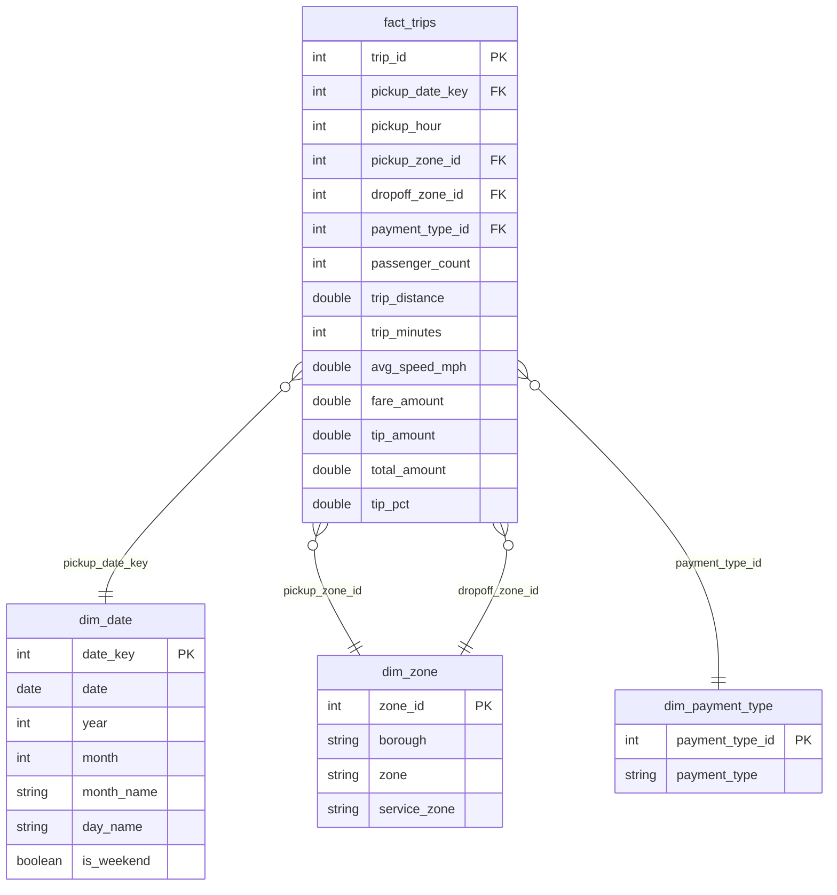
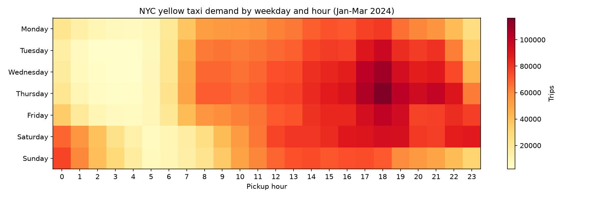
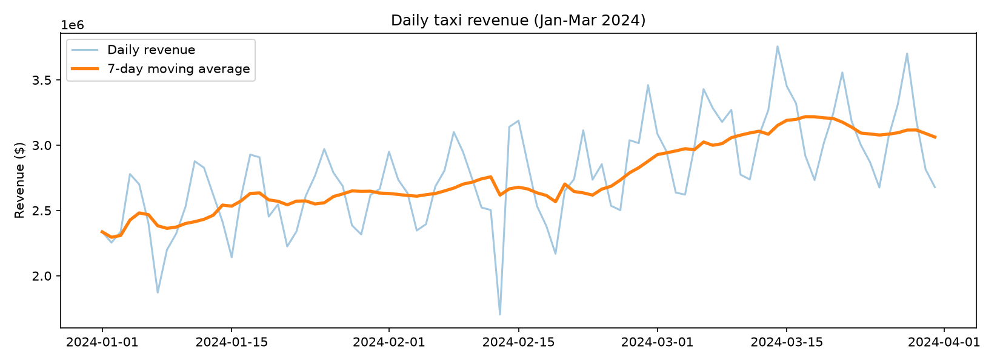
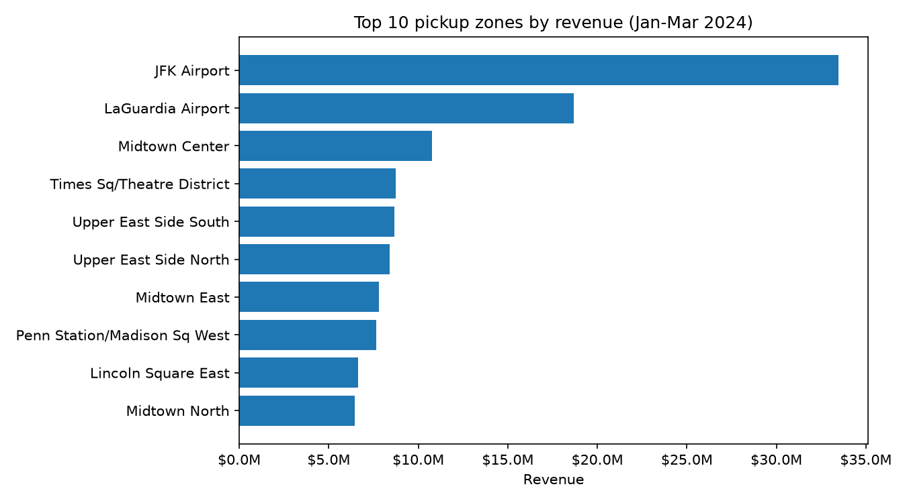

# NYC Taxi Analytics Warehouse with DuckDB

> 🗄️ SQL, Data Modelling & Analytics Engineering Project
> **Database:** DuckDB | **Language:** SQL + Python | **Data:** NYC Yellow Taxi trips (Jan–Mar 2024)

This project builds a small **analytical data warehouse** from real NYC Taxi & Limousine Commission (TLC) trip data, then uses advanced SQL to answer business questions about taxi demand, revenue, and customer behaviour.

The workflow demonstrates **data loading, data cleaning, dimensional modelling (star schema), data-quality validation, advanced SQL analytics, visualisation, and storage-format performance testing**. The whole pipeline is reproducible with two commands and needs no manual data download.

---

## 📋 Table of Contents

- [🎯 Project Overview](#-project-overview)
- [🔍 Objectives](#-objectives)
- [🧰 Skills Demonstrated](#-skills-demonstrated)
- [🛠️ Technologies](#%EF%B8%8F-technologies)
- [📊 Pipeline Workflow](#-pipeline-workflow)
- [🧱 Data Model (Star Schema)](#-data-model-star-schema)
- [🧹 Data Cleaning & Quality Checks](#-data-cleaning--quality-checks)
- [📈 Analysis Queries](#-analysis-queries)
- [💡 Key Insights](#-key-insights)
- [⚡ Performance Comparison](#-performance-comparison)
- [🔭 Limitations & Future Work](#-limitations--future-work)
- [📁 Repository Structure](#-repository-structure)
- [🚀 How to Run](#-how-to-run)
- [🧠 Design Decisions](#-design-decisions)
- [📂 Data](#-data)
- [👤 About](#-about)

## 🎯 Project Overview

The goal was to show, end to end, how raw operational data becomes a clean, trustworthy analytics database that can answer real business questions.

### 🚕 NYC Yellow Taxi Data

The dataset is published by the NYC Taxi & Limousine Commission and contains millions of individual trips, including:

- Pickup and dropoff timestamps
- Pickup and dropoff zones
- Passenger count and trip distance
- Fare, tip, tolls, and total amount
- Payment type

This project uses **January–March 2024** (roughly 9 million trips), plus the official **taxi zone lookup table** (zone names and boroughs).

### 🦆 Why DuckDB?

DuckDB is an in-process analytical database: no server, no installation wizard, no passwords. The whole database is a single file. It is built for analytical queries, handles millions of rows on a laptop, and can read Parquet and CSV files directly from disk or from a URL.

## 🔍 Objectives

The main objectives were to:

- 📥 **Ingest** raw data directly from a public URL (no manual downloads)
- 🧹 **Clean** the data by removing impossible or corrupted trips
- 🧱 **Model** the data as a **star schema** (one fact table + dimension tables)
- ✅ **Validate** the result with automated data-quality checks
- 📈 **Analyse** demand, revenue, and trends using advanced SQL
- 📊 **Visualise** the main results
- ⚡ **Measure** how storage format (DuckDB vs Parquet vs CSV) affects query speed

## 🧰 Skills Demonstrated

| Area                       | Where to see it                                                              |
| -------------------------- | ---------------------------------------------------------------------------- |
| **Advanced SQL**           | Window functions, `LAG`, moving averages, CTEs, `QUALIFY`, `PIVOT`, `FILTER` (`analysis/`) |
| **Data modelling**         | Star schema with surrogate keys and dimension tables (`sql/03_star_schema.sql`) |
| **Data cleaning**          | Rule-based filtering of invalid records (`sql/02_staging.sql`)                |
| **Data quality**           | Automated referential-integrity and uniqueness tests that fail the build (`sql/04_checks.sql`) |
| **Query performance**      | Row vs column storage benchmark with measured timings (`performance.py`)      |
| **Reproducible workflow**  | Whole pipeline runs from two commands, no manual downloads                   |

## 🛠️ Technologies

| Technology     | Purpose                                                    |
| -------------- | ---------------------------------------------------------- |
| **DuckDB**     | Analytical database engine                                 |
| **SQL**        | Data cleaning, modelling, validation, and analysis         |
| **Python**     | Pipeline scripts that run the SQL files                    |
| **Parquet**    | Source data format (and used in the performance test)      |
| **pandas**     | Reading result CSVs for plotting                           |
| **matplotlib** | Charts and heatmap                                         |
| **Git/GitHub** | Version control                                            |

## 📊 Pipeline Workflow

The data moves through three layers, each stored in its own schema:

```
┌──────────────────────────────┐   ┌─────────────────────────┐
│ NYC TLC Yellow Taxi Trips    │   │ Taxi Zone Lookup        │
│ Parquet files (Jan–Mar 2024) │   │ CSV                     │
└───────────────┬──────────────┘   └────────────┬────────────┘
                └──────────────┬────────────────┘
                               ▼
                ┌──────────────────────────────┐
                │ 1. RAW layer  (schema: raw)  │
                │                              │
                │ • Data copied exactly as is  │
                │ • Read straight from URL     │
                └──────────────┬───────────────┘
                               ▼
                ┌──────────────────────────────┐
                │ 2. STAGING layer             │
                │    (schema: staging)         │
                │                              │
                │ • Rename & cast columns      │
                │ • Remove invalid trips       │
                │ • Add unique trip_id         │
                └──────────────┬───────────────┘
                               ▼
                ┌──────────────────────────────┐
                │ 3. MART layer  (schema: mart)│
                │                              │
                │ • fact_trips                 │
                │ • dim_date                   │
                │ • dim_zone                   │
                │ • dim_payment_type           │
                └──────────────┬───────────────┘
                               ▼
                ┌──────────────────────────────┐
                │ 4. Data-quality checks       │
                │    (7 automated tests)       │
                └──────────────┬───────────────┘
                               ▼
                ┌──────────────────────────────┐
                │ 5. Analysis + Visualisation  │
                │                              │
                │ • 6 SQL analysis queries     │
                │ • CSV results                │
                │ • 3 charts                   │
                └──────────────────────────────┘
```

**Why three layers?** Keeping raw data untouched means the pipeline is reproducible and auditable: if a cleaning rule changes, only the staging layer is rebuilt, and the original data is never lost.

## 🧱 Data Model (Star Schema)

The final layer follows a **star schema**, the standard design for analytical databases: one central **fact table** (events you measure) surrounded by **dimension tables** (the context you filter and group by).



| Table                | Type      | Grain / content                                        |
| -------------------- | --------- | ------------------------------------------------------ |
| `fact_trips`         | Fact      | One row per taxi trip, with measures and derived fields (duration, speed, tip %) |
| `dim_date`           | Dimension | One row per calendar day, with weekday/weekend flags   |
| `dim_zone`           | Dimension | One row per NYC taxi zone, with borough                |
| `dim_payment_type`   | Dimension | Lookup of payment codes (credit card, cash, etc.)      |

## 🧹 Data Cleaning & Quality Checks

### Cleaning rules (staging layer)

Raw taxi data contains errors (GPS glitches, test records, meter faults). Trips were removed if they:

- 📅 Started **outside** January–March 2024
- ⏪ Ended **before or at** the pickup time
- ⏱️ Lasted **6 hours or more** (almost certainly meter errors)
- 📏 Had a **distance of 0 or less**
- 💵 Had a **fare or total amount of 0 or less**

### Automated quality checks

After building the warehouse, `build.py` runs `sql/04_checks.sql`. Each check returns the number of violations, and **0 means pass**. If any check fails, the script exits with an error.

| Check                                       | What it proves                                  |
| ------------------------------------------- | ----------------------------------------------- |
| Fact table has rows                         | The pipeline loaded data                        |
| `trip_id` is unique                         | No duplicate trips                              |
| Pickup zone exists in `dim_zone`            | No broken foreign keys                          |
| Dropoff zone exists in `dim_zone`           | No broken foreign keys                          |
| Pickup date exists in `dim_date`            | No trips outside the date dimension             |
| Payment type exists in `dim_payment_type`   | No unknown payment codes                        |
| No negative amounts                         | Cleaning rules worked                           |

**Result:** all 7 checks passed with **0 violations**.

## 📈 Analysis Queries

Six queries in `analysis/`, each answering a business question and demonstrating a different SQL technique:

| #  | File                           | Business question                                                    | SQL techniques                                  |
| -- | ------------------------------ | -------------------------------------------------------------------- | ----------------------------------------------- |
| 01 | `01_top_zones.sql`             | Which pickup zones earn the most revenue, and what share of the total? | `JOIN`, `GROUP BY`, window over aggregate, `RANK()` |
| 02 | `02_moving_average.sql`        | How does daily revenue trend once weekly seasonality is smoothed?    | CTE, window frame (`ROWS BETWEEN 6 PRECEDING`)  |
| 03 | `03_week_over_week.sql`        | Which days had a revenue drop of more than 15% vs the same weekday last week? | CTE, `LAG()`                          |
| 04 | `04_top3_per_borough.sql`      | What are the 3 busiest pickup zones in each borough?                 | `ROW_NUMBER()`, `QUALIFY` (DuckDB)              |
| 05 | `05_borough_month_pivot.sql`   | How does revenue compare across boroughs and months?                 | `PIVOT` (DuckDB)                                |
| 06 | `06_demand_heatmap.sql`        | When is demand highest by weekday and hour?                          | multi-column `GROUP BY`, `FILTER` clause        |

Results are exported automatically to the `results/` folder as CSV files.

### Example: top 3 zones per borough

DuckDB's `QUALIFY` clause filters on window functions directly, so no subquery is needed:

```sql
SELECT z.borough, z.zone, count(*) AS trips
FROM mart.fact_trips f
JOIN mart.dim_zone z ON f.pickup_zone_id = z.zone_id
WHERE z.borough NOT IN ('Unknown', 'N/A')
GROUP BY z.borough, z.zone
QUALIFY row_number() OVER (PARTITION BY z.borough ORDER BY count(*) DESC) <= 3
ORDER BY z.borough, trips DESC;
```

## 💡 Key Insights

> ✏️ **Replace the `XX` values below with the real numbers from your `results/` CSVs before publishing.**

| Finding                         | Result                                                                                         |
| ------------------------------- | ---------------------------------------------------------------------------------------------- |
| 🧹 **Data quality**             | **XX million** trips loaded, **XX** kept after cleaning (**XX%** removed). All 7 quality checks passed. |
| 💰 **Top revenue zone**         | **XX** was the highest-earning pickup zone with **XX%** of total revenue.                      |
| ⏰ **Peak demand**              | Weekday demand peaks around **XX:00–XX:00**, while weekends peak at **XX:00**.                 |
| 📉 **Revenue anomalies**        | Revenue fell **XX%** on **DATE** compared with the previous week (possible cause: weather / holiday). |
| 🏙️ **Borough comparison**       | **Manhattan** generated **XX%** of revenue, far ahead of the other boroughs.                   |

### 🔥 Demand by weekday and hour



> ✏️ *One sentence on what the heatmap shows, e.g. "Weekday demand peaks during the evening rush, while Friday and Saturday nights stay busy late."*

### 📅 Daily revenue and 7-day moving average



> ✏️ *One sentence on the trend and the main dips.*

### 🏆 Top 10 pickup zones by revenue



> ✏️ *One sentence on which zones dominate and why (airports, Midtown, etc.).*

## ⚡ Performance Comparison

`performance.py` tests whether **storage format** affects query speed. The same fact table was exported to **Parquet** and **CSV**, and the same aggregation query was run on all three sources (best of 3 runs):

> ✏️ **Paste the table printed by `python performance.py` here.**

| Source       | Size (MB) | Query time (s) |
| ------------ | --------- | -------------- |
| DuckDB table | -         | XX             |
| Parquet file | XX        | XX             |
| CSV file     | XX        | XX             |

**Why the difference?** Parquet is **columnar and compressed**: the query only reads the columns it needs (`pickup_hour`, `total_amount`). CSV is plain text, so the database must read and parse every column of every row. Parquet is therefore smaller and much faster to query. The native DuckDB table is optimised for exactly this kind of analytical workload.

> Timings depend on the machine, so treat them as relative comparisons rather than absolute benchmarks. The exported `fact_trips.parquet` and `fact_trips.csv` files are temporary and excluded from the repository via `.gitignore`. They can be regenerated at any time with `performance.py`.

## 🔭 Limitations & Future Work

**Limitations**

- Only **three months** of one taxi type (yellow) are loaded, so seasonal conclusions are limited.
- **Cash tips are not recorded** in the TLC data, so tip analysis only uses credit-card trips.
- The cleaning thresholds (for example, the 6-hour cap) are reasonable judgement calls, not official rules.

**Possible extensions**

- Load a full year and add a recursive-CTE date spine
- Add trip **sessionization** or cohort analysis
- Rebuild the SQL layers as **dbt-duckdb** models with built-in tests
- Add a **GitHub Actions** workflow that runs `build.py` on every push
- Build a small dashboard (Streamlit or Evidence) on top of the mart layer

## 📁 Repository Structure

```
nyc-taxi-duckdb/
│
├── 🐍 build.py              # Builds the warehouse + runs quality checks
├── 🐍 analyze.py            # Runs analysis queries, exports CSVs
├── 🐍 plot_charts.py        # Creates the 3 charts
├── 🐍 performance.py        # CSV vs Parquet vs DuckDB benchmark
│
├── 📂 sql/
│   ├── 01_raw.sql           # Load raw data from URL
│   ├── 02_staging.sql       # Clean and standardise
│   ├── 03_star_schema.sql   # Fact + dimension tables
│   └── 04_checks.sql        # Data-quality tests
│
├── 📂 analysis/
│   ├── 01_top_zones.sql
│   ├── 02_moving_average.sql
│   ├── 03_week_over_week.sql
│   ├── 04_top3_per_borough.sql
│   ├── 05_borough_month_pivot.sql
│   └── 06_demand_heatmap.sql
│
├── 📂 results/              # CSV outputs + PNG charts
│
├── 📄 requirements.txt
├── 📄 .gitignore
└── 📄 README.md
```

## 🚀 How to Run

**Requirements:** Python 3.9+ and an internet connection (the first run downloads about 150 MB of data). No manual data download and no database installation are needed.

```bash
# 1. Clone the repository
git clone https://github.com/YOUR_USERNAME/nyc-taxi-duckdb.git
cd nyc-taxi-duckdb

# 2. Create and activate a virtual environment
python -m venv myenv
source myenv/Scripts/activate      # Git Bash on Windows
# source myenv/bin/activate        # Mac / Linux

# 3. Install dependencies
pip install -r requirements.txt

# 4. Build the warehouse (downloads data, cleans, models, runs checks)
python build.py

# 5. Run the analysis queries (prints tables and saves CSVs to results/)
python analyze.py

# 6. Create the charts
python plot_charts.py

# 7. (Optional) Run the storage-format benchmark
python performance.py
```

`build.py` creates a local file called `taxi.duckdb`. Rerun `build.py` only if you change the SQL in `sql/`, and rerun `analyze.py` only if you change the queries in `analysis/`.

## 🧠 Design Decisions

| Decision                          | Reason                                                                                      |
| --------------------------------- | ------------------------------------------------------------------------------------------- |
| **DuckDB instead of a server DB** | Zero setup, fast analytics on a laptop, reads Parquet/CSV natively, easy for anyone to reproduce. |
| **Raw → Staging → Mart layers**   | Keeps original data untouched and separates cleaning from modelling.                        |
| **Star schema**                   | Standard analytical design: simple joins, fast aggregations, easy to understand.            |
| **SQL kept in separate `.sql` files** | Readable, reusable, and easy to review; Python only orchestrates.                       |
| **Quality checks that fail the build** | Bad data is caught immediately instead of silently producing wrong results.            |
| **Strict cleaning rules**         | Removing impossible trips prevents distorted averages (for example, absurd speeds or fares). |
| **Derived columns in the fact table** | Duration, speed, and tip % are computed once instead of in every query.                 |
| **Tip analysis limited to card payments** | The TLC data does not record cash tips, so including cash trips would understate average tips. |

## 📂 Data

All data comes from public sources published by the **NYC Taxi & Limousine Commission (TLC)**:

- 🚕 **Yellow Taxi Trip Records** (Parquet), January–March 2024
- 🗺️ **Taxi Zone Lookup Table** (CSV)

The data is **downloaded automatically** by `sql/01_raw.sql` when you run `build.py`, so it is **not stored in this repository**. To analyse more months, change the `range(1, 4)` in `sql/01_raw.sql` (and the date filters in `sql/02_staging.sql` and `sql/03_star_schema.sql`).

## 👤 About

**Iulia Sapungiu**
🎓 MSc Data Science — The University of Sheffield

> 📝 **Note:** This project was created to demonstrate SQL, database design, and analytics engineering skills as part of my **data science and data engineering portfolio**. The data is public and belongs to the NYC TLC.

**© 2026 Iulia Sapungiu**
